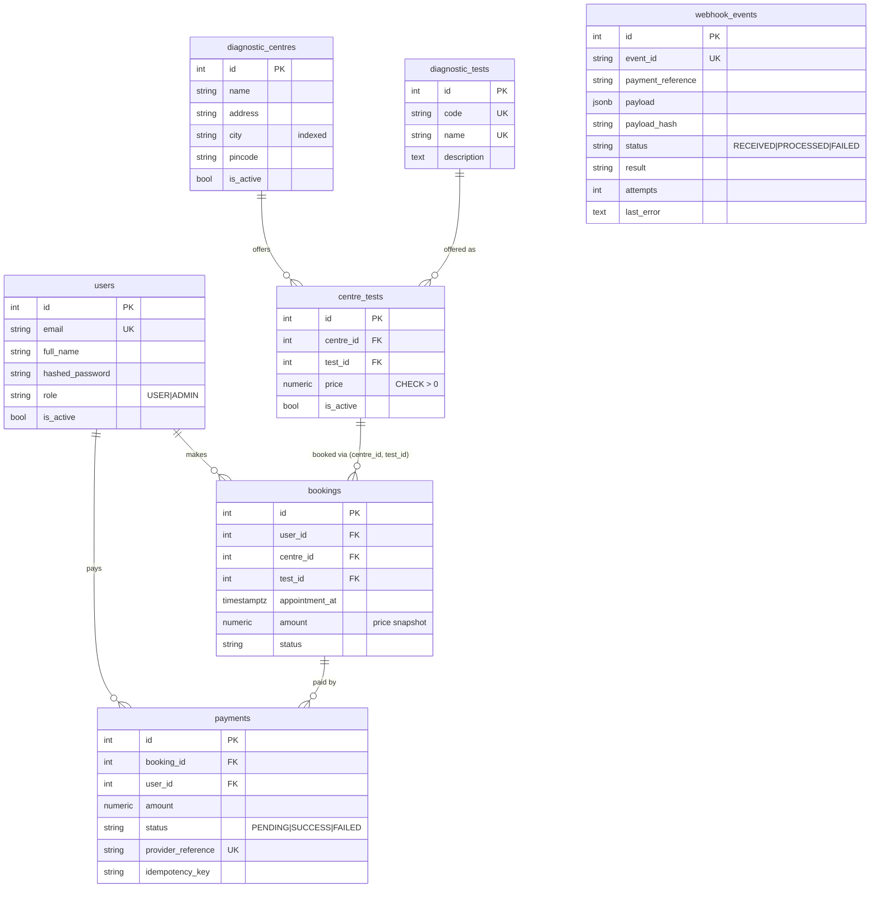
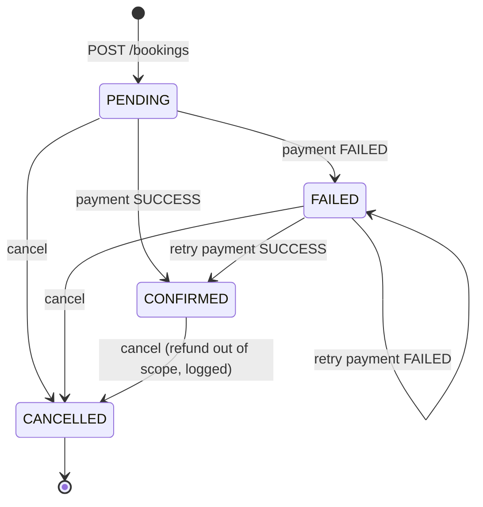

# EVE Diagnostics Booking API

A backend service for booking diagnostic tests, with a simulated payment gateway and an **idempotent** payment webhook.

**Stack:** FastAPI · SQLAlchemy 2 · PostgreSQL · Alembic · Redis · JWT · pytest · Docker

| Requirement | Where |
|---|---|
| Signup / login / JWT / validation | `app/api/routes/auth.py`, `app/schemas/auth.py` |
| Centres & tests with prices | `app/api/routes/centres.py`, `app/services/centre_service.py` |
| Bookings (PENDING / CONFIRMED / FAILED / CANCELLED) | `app/services/booking_service.py` |
| Simulated payment `POST /payments/` | `app/services/payment_service.py` |
| Idempotent webhook `POST /payments/webhook/` | `app/services/webhook_service.py` |
| Edge cases | see [Edge cases](#edge-cases-handled) |
| Bonus | Docker, Swagger, 68 tests (incl. real concurrency tests), Redis caching, rate limiting, pagination, structured JSON logs, webhook retry/replay |

---

## Running locally

### Option A: Docker (recommended)

```bash
docker compose up --build
```

- API: http://localhost:8000
- Swagger UI: http://localhost:8000/docs (ReDoc at `/redoc`)
- On start the container runs `alembic upgrade head` and seeds demo data, including an admin account (`admin@eve.local` / `Admin@12345`) and 3 centres with 5 tests.

Run the tests inside Docker against real PostgreSQL:

```bash
docker compose run --rm api pytest     # uses TEST_DATABASE_URL -> eve_test database
```

### Option B: Python virtualenv

Requires Python 3.12+ and PostgreSQL. Redis is optional; without it, caching and rate limiting fall back to an in-process store.

```bash
python -m venv .venv && source .venv/bin/activate
pip install -r requirements-dev.txt
cp .env.example .env            # then edit DATABASE_URL etc.
createdb eve
alembic upgrade head
python -m app.seed              # admin + sample centres (safe to re-run)
uvicorn app.main:app --reload
```

### Tests

```bash
pytest                                                      # zero-setup: throwaway SQLite
TEST_DATABASE_URL=postgresql+psycopg://localhost/eve_test pytest   # full suite on Postgres
```

`tests/test_concurrency.py` only runs on PostgreSQL, because it needs real row locks. It fires 8 simultaneous requests and asserts that:

- a webhook is applied exactly once,
- a booking is charged exactly once,
- concurrent retries with the same `Idempotency-Key` produce a single payment.

---

## Walkthrough (curl)

```bash
B=http://localhost:8000

# 1. Sign up and log in
curl -s -XPOST $B/auth/signup -H 'content-type: application/json' \
  -d '{"email":"riya@example.com","password":"Secret123","full_name":"Riya"}'
TOKEN=$(curl -s -XPOST $B/auth/login -H 'content-type: application/json' \
  -d '{"email":"riya@example.com","password":"Secret123"}' | jq -r .access_token)

# 2. Browse centres
curl -s "$B/centres?city=bengaluru&test_id=1"
curl -s $B/centres/1

# 3. Book a test (amount is taken from the centre's price, not from the client)
curl -s -XPOST $B/bookings -H "Authorization: Bearer $TOKEN" -H 'content-type: application/json' \
  -d '{"centre_id":1,"test_id":1,"appointment_at":"2030-01-15T09:30:00+05:30"}'

# 4. Pay (simulate_outcome is optional; if omitted, it succeeds with PAYMENT_SUCCESS_RATE)
curl -s -XPOST $B/payments/ -H "Authorization: Bearer $TOKEN" -H 'Idempotency-Key: order-1' \
  -H 'content-type: application/json' -d '{"booking_id":1,"simulate_outcome":"FAILED"}'
# -> {"payment":{"status":"FAILED","provider_reference":"pay_…",…},"booking_status":"FAILED"}

# 5. The provider later reports success through the webhook; the script signs the
#    request and sends it 3 times to show idempotency
python scripts/send_webhook.py --booking-id 1 --reference pay_… --amount 350.00 \
  --event payment.succeeded --times 3
# [1] 200 {"status":"processed","result":"applied","booking_status":"CONFIRMED",…}
# [2] 200 {"status":"duplicate",…}
# [3] 200 {"status":"duplicate",…}
```

---

## API

All request and response bodies are JSON. Protected endpoints need `Authorization: Bearer <token>`.

| Method | Path | Auth | Description |
|---|---|---|---|
| POST | `/auth/signup` | – | Create an account (always role `USER`) |
| POST | `/auth/login` | – | Returns `{access_token, token_type, expires_in}` |
| GET | `/auth/me` | user | Current user |
| GET | `/centres?city=&test_id=&limit=&offset=` | – | Active centres, filterable, paginated, cached |
| GET | `/centres/{id}` | – | Centre with its active tests and prices (cached) |
| GET | `/tests?q=&limit=&offset=` | – | Test catalogue with search |
| POST | `/tests` | admin | Add a test to the catalogue |
| POST | `/centres` | admin | Create a centre |
| PATCH | `/centres/{id}` | admin | Update or deactivate a centre |
| POST | `/centres/{id}/tests` | admin | Offer a test at a centre with a price |
| PATCH | `/centres/{id}/tests/{test_id}` | admin | Change the price or deactivate an offering |
| POST | `/bookings` | user | Book a test (status `PENDING`) |
| GET | `/bookings?status=&limit=&offset=` | user | Your bookings, newest first (admins see all) |
| GET | `/bookings/{id}` | owner/admin | Booking detail |
| POST | `/bookings/{id}/cancel` | owner/admin | Cancel a booking |
| GET | `/bookings/{id}/payments` | owner/admin | Payment attempts for a booking |
| POST | `/payments/` | owner | Simulated payment → `SUCCESS` or `FAILED`. Optional `Idempotency-Key` header |
| GET | `/payments/{id}` | owner/admin | Payment detail |
| POST | `/payments/webhook/` | HMAC signature | Provider → us payment-status event (idempotent) |
| POST | `/payments/webhook/events/{event_id}/replay` | admin | Re-run a stored event (for example one that failed) |
| GET | `/health` | – | Liveness plus a DB check |

**Pagination** responses look like `{"items":[…], "total": 42, "limit": 20, "offset": 0}`. `limit` must be between 1 and 100.

**Errors** always have the same shape, so clients can branch on `code`:

```json
{"error": {"code": "BOOKING_ALREADY_PAID", "message": "Booking is already paid", "details": null}}
```

| Status | Meaning |
|---|---|
| 401 | Missing, invalid or expired token, or bad webhook signature |
| 403 | Authenticated but not allowed (for example a non-admin writing centres) |
| 404 | Resource doesn't exist **or isn't yours** |
| 409 | Request conflicts with the current state (already paid, duplicate booking, reused key or event id) |
| 422 | Validation error |
| 429 | Rate limited |

### Webhook contract

```http
POST /payments/webhook/
X-Webhook-Signature: hex(HMAC_SHA256(WEBHOOK_SECRET, raw_body))

{
  "event_id": "evt_7f3a9c",               // provider's unique id for this event
  "event_type": "payment.succeeded",      // or "payment.failed"
  "payment_reference": "pay_1a2b3c",      // provider's payment id
  "booking_id": 1,
  "amount": "350.00",
  "failure_reason": null
}
```

The endpoint returns `200 {"status": "processed" | "duplicate", "result": …, "booking_status": …, "payment_status": …}`.

---

## Design

### Layout

```
app/
  api/routes/      thin HTTP layer: parse, authorise, call a service, shape the response
  api/deps.py      DB session, current user, admin guard
  services/        business rules (state machine, payments, webhook idempotency)
  models/          SQLAlchemy models and enums
  schemas/         Pydantic request/response models (validation lives here)
  core/            config, JWT/HMAC, errors, JSON logging, cache, rate limiting
alembic/           migrations
tests/             API-level tests, plus Postgres-only concurrency tests
scripts/           webhook sender, Docker entrypoint
```

Routes never contain business logic. Services raise typed errors (`NotFoundError`, `ConflictError`, …), and a single handler turns them into the error format above.

### Database schema



Key decisions:

- **Price lives on `centre_tests`, not on `diagnostic_tests`.** The same test (CBC) costs different amounts at different centres.
- **`bookings.amount` is a snapshot** taken at booking time. Later price changes don't affect existing bookings, and the client never sends an amount.
- **Composite FK `bookings(centre_id, test_id) → centre_tests(centre_id, test_id)`.** The database itself guarantees that a booking only references a test the centre actually offers.
- **Partial unique index `uq_bookings_active_slot`** on `(user_id, centre_id, test_id, appointment_at) WHERE status IN ('PENDING','CONFIRMED')`. This blocks duplicate live bookings even under a race, while still allowing a re-booking after a cancellation or failure.
- **`payments.provider_reference` is unique.** A webhook can never create a second payment for the same provider payment.
- **`UNIQUE(payments.user_id, idempotency_key)`** backs client-side payment retries.
- **`webhook_events.event_id` is unique.** It is the inbox and idempotency record for provider events.
- **Money uses `NUMERIC(10,2)`** (serialised as strings like `"350.00"`), never floats. CHECK constraints enforce `> 0`.
- **Enums are stored as `VARCHAR` plus a `CHECK` constraint**, which is easier to evolve than native PG enums. All timestamps are `timestamptz` in UTC.
- **Migrations are managed by Alembic** with a deterministic constraint naming convention, and `alembic check` reports no drift.

### Booking state machine



Transitions are defined in one table (`ALLOWED_TRANSITIONS` in `booking_service.py`), and every change goes through `transition()`, which rejects illegal moves with a 409.

### Payments and concurrency

`POST /payments/` performs these steps:

1. Locks the booking row (`SELECT … FOR UPDATE`), so parallel payment attempts for one booking are serialised.
2. Checks for an `Idempotency-Key` replay. If found, it returns the original payment with `200` and `Idempotent-Replayed: true`, without charging again.
3. Validates the booking state: it must be `PENDING` or `FAILED`, not already paid, not cancelled, and the appointment must not have passed.
4. Creates the payment for the booking's amount, simulates the gateway and applies the outcome in the same transaction.

### How the webhook stays idempotent

The full logic is in `app/services/webhook_service.py`.

1. **Authenticate:** verify the HMAC-SHA256 signature over the *raw* body with a constant-time compare. Unsigned or forged requests get `401` and nothing is stored.
2. **Record:** insert the event into `webhook_events`, keyed by the unique `event_id`, and commit, so receipt is durable. A concurrent duplicate insert hits the unique constraint and is ignored.
3. **Lock:** `SELECT … FOR UPDATE` on the event row. Concurrent deliveries of the same event queue up here.
4. **Decide:**
   - If the stored payload hash differs, the event id was reused for a different body → `409`, and nothing changes.
   - If the event is already `PROCESSED`, return `duplicate`. Nothing is applied again.
   - If it is `RECEIVED` or `FAILED`, process it. A `FAILED` event is retried, which is how redelivery recovers.
5. **Apply:** lock the booking, validate the amount and reference, get or create the payment by `provider_reference`, then apply the outcome using rules that are safe regardless of the order events arrive in:
   - `SUCCESS` is terminal. A late `payment.failed` is recorded as `ignored_stale` and never downgrades it.
   - Re-applying the same status is a no-op.
   - A success on a **cancelled** booking doesn't resurrect it. It is recorded and logged as `applied_refund_required`.
   - A failed payment never un-confirms a booking that another payment already confirmed.
6. **Finish:** mark the event `PROCESSED` with its `result` in the same transaction as the state change. If anything raises, the transaction rolls back and the event is saved as `FAILED` with `attempts` and `last_error`. The provider's redelivery, or the admin `…/replay` endpoint, then retries it.

---

## Edge cases handled

| Case | Behaviour |
|---|---|
| Invalid or missing fields, bad email, weak password, bad dates, >2dp prices | 422 `VALIDATION_ERROR` with a per-field `details` list |
| Appointment in the past (any timezone) | 422. Naive datetimes are treated as UTC; everything is stored in UTC |
| Test not offered at the centre, or offering deactivated | 422 `TEST_NOT_OFFERED` |
| Unknown centre, booking or payment ids | 404 with a specific code |
| Another user's booking or payment (read, cancel, pay) | 404, the same as nonexistent, so ids can't be enumerated |
| Non-admin writing centres or tests | 403 `ADMIN_REQUIRED` |
| Missing, forged or expired JWT, or a deactivated user | 401 |
| Signup with `"role": "ADMIN"` | Ignored; always `USER` |
| Duplicate email (any case) | 409, including concurrent signups (unique index) |
| Same user booking the same slot twice | 409 `DUPLICATE_BOOKING` (plus a DB partial unique index for races) |
| Client sending its own `amount` | Ignored; the server-side price is used |
| Paying an already-paid, cancelled or past booking | 409 with a specific code |
| Double-click or network retry on payment | `Idempotency-Key` replays; without a key, the row lock plus state check gives one charge and 409 for the rest |
| Idempotency key reused for another booking | 409 `IDEMPOTENCY_KEY_REUSED` |
| Failed payment | Booking → `FAILED`; the user can retry payment |
| Webhook delivered N times, even concurrently | Applied once; the rest return `duplicate` |
| Same `event_id`, different body | 409 `EVENT_ID_CONFLICT` |
| Out-of-order events (fail after success) | `ignored_stale`; stays `SUCCESS`/`CONFIRMED` |
| Webhook for an unknown booking, wrong amount, or reference belonging to another booking | 404 / 422 / 409; event stored as `FAILED` with the reason |
| Crash mid-processing | Rolled back; event `FAILED`; retried on redelivery or replay |
| `null` in PATCH for a required field, or an empty PATCH | 422 (instead of a DB error) |
| Redis down | Cache and rate limiter fail open; the API keeps working |

---

## Bonus engineering

- **Docker:** `Dockerfile` (non-root user, cached dependency layer) and `docker-compose.yml` (Postgres, Redis and API with healthchecks). Migrations and seeding run on start.
- **OpenAPI:** Swagger at `/docs`, including the webhook body and signature header.
- **Tests:** 68 tests covering the API, idempotency, retries and races (see [Tests](#tests)).
- **Redis caching:** centre and test reads are cached. Admin writes bump a namespace version, so stale data is never served after a change.
- **Rate limiting:** a fixed window per IP on `/auth/*` and `/payments/`, stored in Redis, with `X-RateLimit-*` headers and a 429 response.
- **Structured logging:** one JSON line per event with a `request_id` (taken from `X-Request-ID` or generated, and echoed back). Domain events such as `booking_status_changed`, `payment_processed`, `webhook_duplicate_ignored` and `payment_succeeded_refund_required` are logged.
- **Webhook retry handling:** failed events are persisted with `attempts` and `last_error`, retried on redelivery, and can be replayed by an admin.
- **Pagination** on every list endpoint.

---

## Assumptions

- **A test has one price per centre.** Admins manage centres, tests and prices. Admin accounts are provisioned out of band (seed script or DB), never through public signup.
- **Payments:**
  - `POST /payments/` is synchronous and always ends in `SUCCESS` or `FAILED`.
  - The webhook is the provider's asynchronous confirmation and is treated as the source of truth, except that a `SUCCESS` is never reversed.
  - The webhook may reference a payment we haven't recorded yet (for example if the provider calls back before our request finishes). In that case the payment is created once, keyed by `provider_reference`.
- **A `FAILED` booking can be paid again.** `CANCELLED` is terminal. Cancelling a `CONFIRMED` booking is allowed, but actual refunds are out of scope and only logged.
- **Access and time rules:**
  - Admins can view all bookings but cannot pay on a patient's behalf.
  - Appointments can't be cancelled or paid for after their time has passed.
  - Capacity or slot limits per centre are not modelled.
- **Webhook responses:** domain errors (unknown booking, amount mismatch) return 4xx and are stored as `FAILED`, so a corrected redelivery or an admin replay can recover them.
- **Auth:** JWTs are short-lived access tokens (60 minutes by default) signed with HS256. There are no refresh tokens.

## What I'd improve with more time

- **Background processing:** make the webhook endpoint only verify, store and return `202`, then process events in a Celery/RQ worker with exponential backoff and a dead-letter state. A periodic job would expire stale `PENDING` bookings and sweep `FAILED` events.
- **Real gateway flow:** payment intents that start as `PENDING` and are resolved only by the webhook, plus refunds for `applied_refund_required` cases and cancelled confirmed bookings.
- **Slots and capacity:** per-centre time slots with capacity, and locking so a slot can't be overbooked.
- **Auth hardening:** refresh tokens with rotation and revocation, email verification, password reset, account lockout, and RS256 with key rotation.
- **Webhook security:** a timestamp in the signed payload to reject replayed old requests, plus secret rotation.
- **Observability:** OpenTelemetry tracing, Prometheus metrics (payment success rate, webhook lag, duplicate counts) and Sentry.
- **Operations and CI:** CI (GitHub Actions running lint, mypy and pytest against a Postgres service), keyset pagination for large tables, and an audit table of booking status changes.
